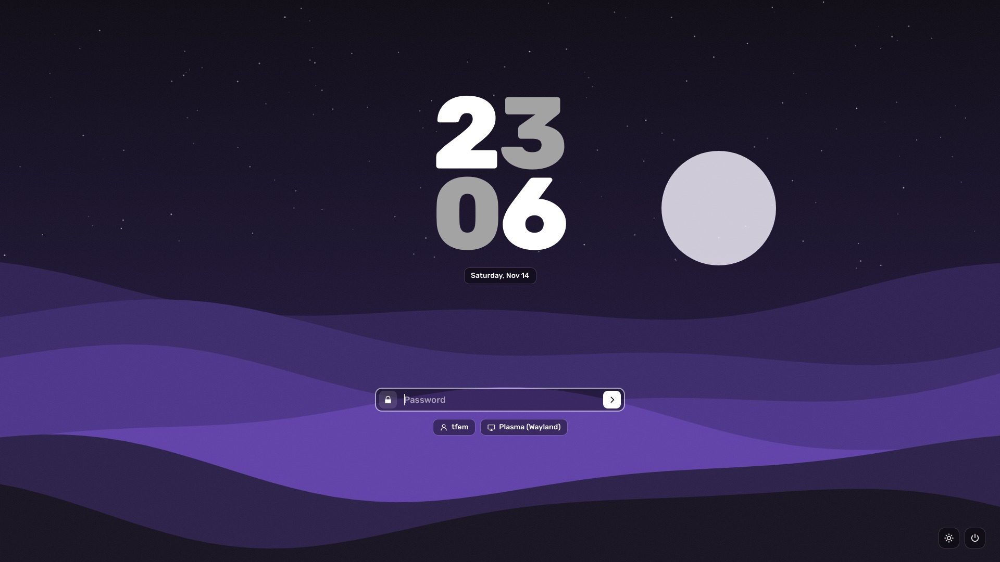
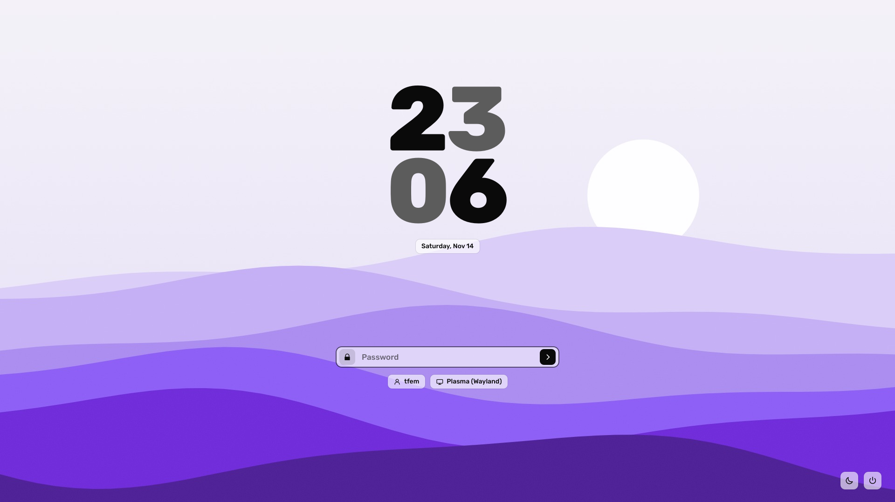

# GraveyardOS login screen (SDDM)

`graveyard/` is the SDDM theme of both desktop editions (KDE and Hyprland),
after the owner's sketches: a large clock with the hours over the minutes,
its digits in two tones, the date under it, then the password (lock on the
left, arrow to sign in), who signs in and which desktop; light/dark and
power at the bottom right. Black and white, like the site and the installer,
over the Graveyard Dunes: the night in dark mode, the day in light mode.

| Dark | Light |
|------|-------|
|  |  |

- A click on the name or on the desktop moves to the next user or session.
- Enter signs in; a wrong password shakes the field and says so; Escape clears.
- The power button opens Suspend / Restart / Shut down (those the machine allows).
- `theme.conf`: `mode` (dark or light at the start), the two backgrounds.
- Icons are vector paths (`Icon.qml`), no icon font; the font is Rubik
  (`fonts/`, SIL Open Font License, from Fontsource).

`iso/desktop.sh` installs it in `/usr/share/sddm/themes/graveyard` with the
Dunes (2560x1600) and selects it. `preview.py` renders the screenshots above
without SDDM (PySide6, SDDM's objects imitated):

    python3 branding/sddm/preview.py /tmp/sddm-preview
